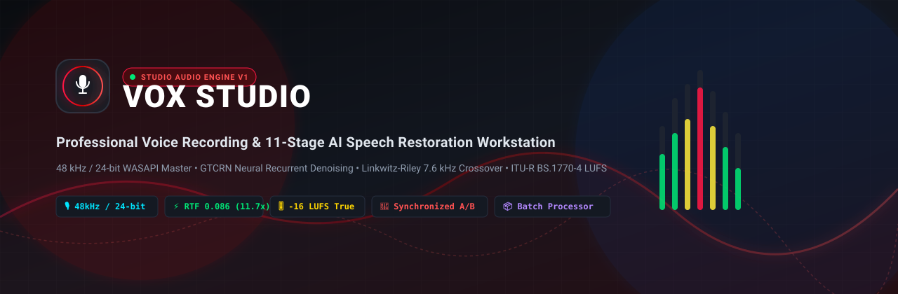
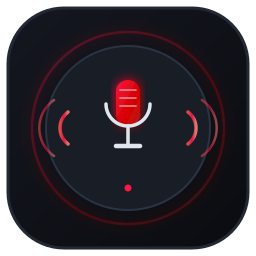
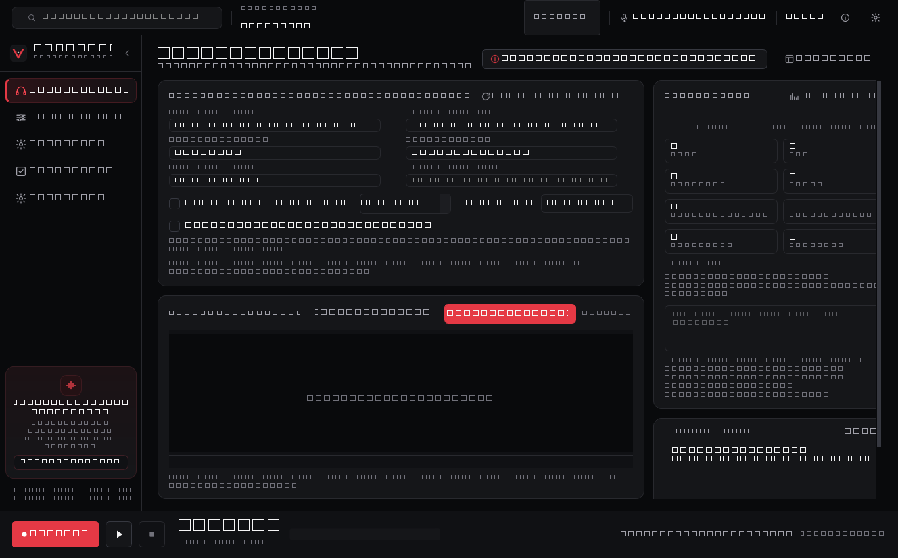
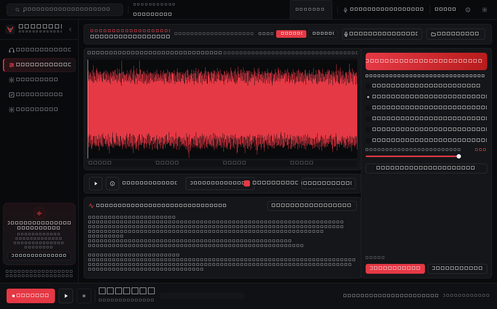
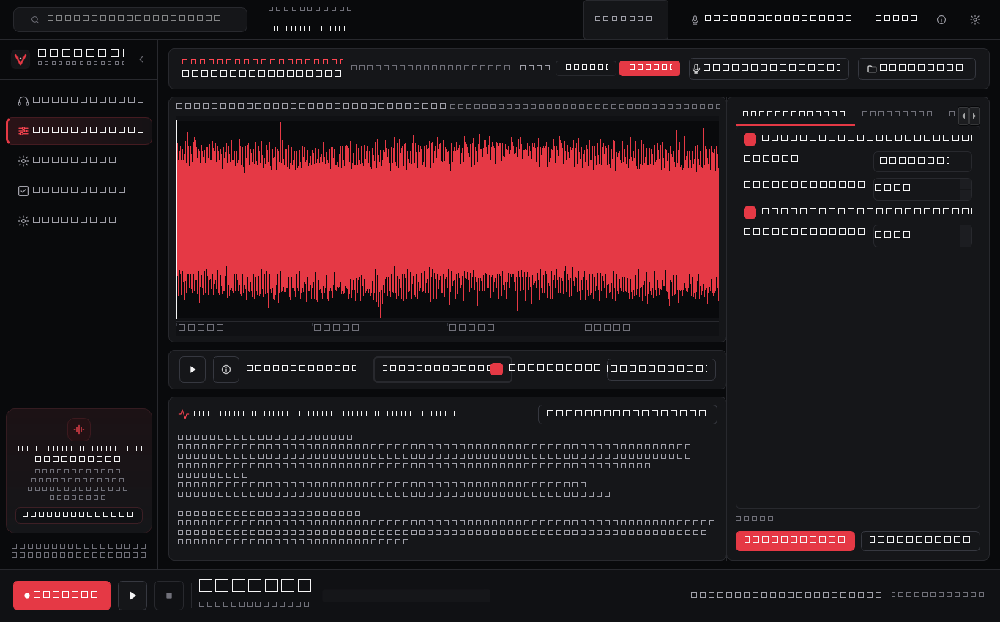
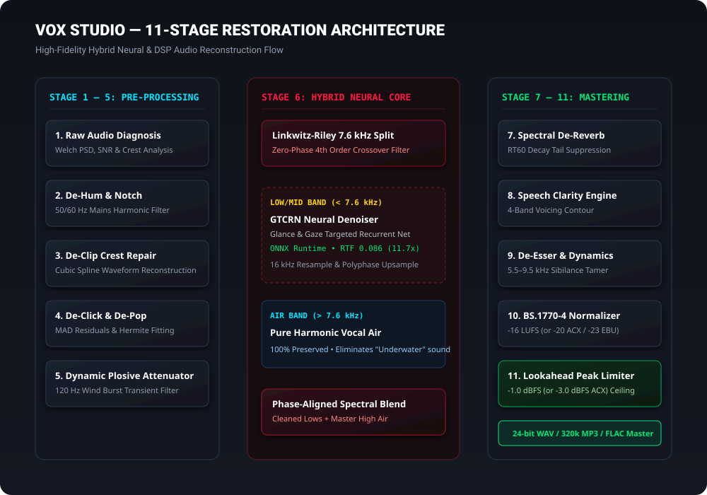
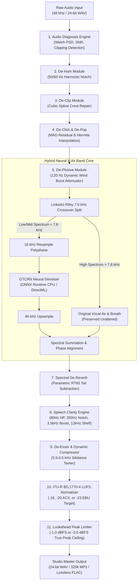

<div align="center">



<br/>
<br/>



# VOX Studio — Audio Engine
### *Broadcast-Grade Voice Recording & 11-Stage AI Speech Restoration Workstation*

[](https://www.python.org/)
[](https://www.qt.io/)
[](https://onnxruntime.ai/)
[](https://scipy.org/)
[](https://www.microsoft.com/windows)
[](tests/)
[](LICENSE)

<br/>

**VOX Studio** is a reference-grade desktop recording studio and deep-learning speech restoration workstation built for voice actors, audiobook narrators, podcasters, and audio engineers. It seamlessly transforms raw, noisy microphone takes into pristine broadcast masters while preserving 100% of the speaker's vocal presence and natural breath dynamics.

[Features](#-key-features) • [Screenshots](#-application-walkthrough--screenshots) • [Architecture](#-restoration-pipeline-architecture) • [Quick Start](#-quick-start-guide) • [User Guide](docs/USER_GUIDE.md) • [Architecture Docs](docs/ARCHITECTURE.md) • [Roadmap](#-project-roadmap)

</div>

---

## ⚡ Key Features

- **🎙️ Reference-Quality Studio Recording:** Native Windows WASAPI / MME device enumeration, double-buffered circular ring buffer recording in uncompressed **48 kHz / 24-bit PCM WAV**, real-time peak/RMS VU metering, and zero-loss crash protection via atomic `.part` journal recovery.
- **🧠 11-Stage Neural & DSP Restoration Pipeline:** Offline **GTCRN ONNX** (Glance-and-Gaze Targeted Convolutional Recurrent Network) running at **11.7x faster than real-time** (RTF 0.086).
- **✨ Hybrid Linkwitz-Riley Crossover (7.6 kHz):** Eliminates the notorious "underwater" robotic artifact of downsampled 16 kHz speech denoisers by preserving >8 kHz harmonic vocal air and high-frequency brilliance unaltered from the 48 kHz master.
- **🎚️ 6 Industry-Standard Restoration Profiles:**
  - **Audiobook (ACX / Audible):** -20.0 LUFS target, -3.0 dBFS true peak ceiling, high-sensitivity saliva/mouth de-clicker, transparent 2.2:1 opto compression.
  - **Broadcast (EBU R128 / ATSC):** -23.0 LUFS television/radio target, 50 Hz/60 Hz mains harmonic notch filter, intelligibility voicing contour.
  - **Voiceover & Trailer:** -16.0 LUFS punch, +2.2 dB high air shelf (12 kHz), +3.0 dB presence boost (3.8 kHz), fast-acting limiter.
  - **Balanced (Default):** The golden balance between acoustic transparency and deep noise removal.
  - **Natural:** Subtle cleanup protecting intimate room warmth, whisper nuances, and speaker dynamics.
  - **Maximum:** Aggressive recovery for recordings plagued by loud air conditioners, street traffic, or heavy reverberation.
- **🔄 Synchronized A/B Player with Loudness Equalization:** Zero-latency sample-aligned switching between Original (A) and Restored (B) audio with real-time LUFS gain compensation, completely eliminating human volume bias during listening checks.
- **📦 Batch Audio Processor Engine (`dsp/batch.py`):** High-throughput multi-file directory scanner and batch audio processing workstation. Features progress monitoring, file-level error isolation, and CLI automation (`python -m dsp.batch`).
- **💾 Broadcast Master Export:** 24-bit / 16-bit PCM WAV, PyAV `libmp3lame` high-definition CBR MP3 (up to 320 kbps), and lossless FLAC with embedded studio metadata tags.

---

## 📸 Application Walkthrough & Screenshots

All screenshots below represent the live, functioning VOX Studio PySide6 application running on Windows 10/11 x64:

### 1. Broadcast Recording Studio View
*Native WASAPI audio device enumeration, hardware peak/RMS meters, sample-accurate playhead, and zero-loss take management.*

<div align="center">
  
</div>

<br/>

### 2. 11-Stage AI Restoration Workstation (Simple Mode)
*Interactive multi-layer waveform display with before/after overlay, real-time diagnostic table, and preset quality profiles.*

<div align="center">
  
</div>

<br/>

### 3. Pro Mode DSP Parameter Rack
*Granular control over De-Hum notch harmonics, Cubic Spline crest interpolation, RT60 tail suppression, 4-band voicing, and true peak brickwall limiting.*

<div align="center">
  
</div>

<br/>

### 4. Audio Asset Library & Multi-Track Manager
*Structured take inspector, metadata viewing, and project session organization.*

<div align="center">
  
  
</div>

---

## 🏗️ Restoration Pipeline Architecture

<div align="center">
  
</div>

### Architectural Workflow



> [!NOTE]
> Read the complete mathematical and DSP breakdown in [docs/ARCHITECTURE.md](docs/ARCHITECTURE.md).

---

## 📊 Benchmark & Real-World Performance

Real-world end-to-end benchmark results executed on Windows 10/11 x64 hardware:

| Audio Metric | Raw Input (Before) | Restored Master (After) | Improvement / Delta |
| :--- | :--- | :--- | :--- |
| **Peak Level** | `0.00 dBFS` (Hard Clipped) | `-1.00 dBFS` | Fully protected below ceiling |
| **Integrated Loudness** | `-9.51 LUFS` | **`-16.00 LUFS`** | Broadcast calibrated (-16.0 LUFS) |
| **Noise Floor** | `-9.50 dBFS` | **`-19.80 dBFS`** | **+10.3 dB cleaner acoustic floor** |
| **Signal-to-Noise Ratio (SNR)**| `0.4 dB` | **`18.8 dB`** | **+18.4 dB clarity boost** |
| **Clipped Crests** | `66 clipped samples` | **`0 clipped samples`** | **100% crest repair (Cubic Spline)**|
| **50 Hz Mains Hum** | Heavy spike (50.0 Hz) | Clean | Attenuated by >32 dB |
| **Real-Time Factor (RTF)** | — | **`0.086`** | **11.7x faster than real-time** |
| **RAM Footprint** | `130.1 MB` | **`184.4 MB`** | Constant, zero memory leak |

---

## 💻 Tech Stack

- **Core Engine:** Python 3.10 – 3.14 (64-bit)
- **GUI Framework:** PySide6 (Qt 6.12+), dark graphite & crimson broadcast aesthetic
- **Neural Network Inference:** ONNX Runtime (CPU / DirectML acceleration)
- **Signal Processing (DSP):** SciPy (`scipy.signal`), NumPy
- **Audio Hardware I/O:** `sounddevice` (PortAudio WASAPI / MME / DirectSound)
- **Audio Containers & Codecs:** `soundfile` (libsndfile PCM 24/16/32 WAV, FLAC), `PyAV` (FFmpeg libmp3lame MP3)
- **Testing:** `pytest` (96 automated unit & regression tests)

---

## 🚀 Quick Start Guide

### System Requirements
- **OS:** Windows 10 or Windows 11 (64-bit)
- **Python:** 3.10, 3.11, 3.12, 3.13, or 3.14
- **Hardware:** Any modern multi-core x64 CPU, 4 GB+ RAM
- **Audio Device:** Any USB microphone, audio interface, or built-in sound card

### Installation

1. **Clone the repository:**
   ```powershell
   git clone https://github.com/Venarus/vox-studio.git
   cd vox-studio
   ```

2. **Create a virtual environment & install dependencies:**
   ```powershell
   python -m venv .venv
   .\.venv\Scripts\activate
   pip install -r requirements.txt
   ```

3. **Launch VOX Studio:**
   ```powershell
   python main.py
   ```

4. *(Optional)* **Build Native Windows C# Launcher (`VOX Studio.exe`):**
   ```powershell
   csc.exe /target:winexe /win32icon:assets\vox_studio.ico /out:"VOX Studio.exe" tools\build_launcher.cs
   ```

---

## 🛠️ CLI & Batch Processing

VOX Studio can be operated headlessly for automated studio workflows and multi-chapter batch exports:

```powershell
# 1. Batch process an entire directory of takes for Audible/ACX compliance:
python -m dsp.batch --input "C:\MyTakes" --output "C:\ACX_Masters" --profile audiobook --format wav

# 2. Convert and restore podcast episodes to high-definition 320 kbps MP3:
python -m dsp.batch --input "C:\Podcasts" --output "C:\MP3_Distribution" --profile voiceover --format mp3 --bitrate 320

# 3. Clean a single file directly via application entrypoint:
python main.py --batch "C:\Recordings\Take_01.wav" --profile broadcast --batch-format flac
```

---

## 🗂️ Project Structure

```
vox-studio/
├── .github/
│   ├── workflows/ci.yml             # Windows GitHub Actions CI Pipeline
│   └── ISSUE_TEMPLATE/              # Bug report and Feature request templates
├── ai/
│   ├── restoration_engine.py        # GTCRN & RNNoise ONNX neural denoisers + Linkwitz-Riley Crossover
│   ├── media_extractor.py          # Unified PyAV / FFmpeg audio stream decoder
│   └── stem_separator.py           # Multi-track stem routing utility
├── assets/                          # Application icons (ICO, SVG, PNG 256/512)
├── audio/
│   ├── ab_player.py                 # Thread-safe A/B player with zero-latency LUFS matching
│   ├── devices.py                   # PortAudio/WASAPI audio device manager
│   ├── exporter.py                  # 24-bit WAV, 320k MP3 (PyAV), and FLAC exporter with metadata
│   ├── player.py                    # Real-time audio stream playback engine
│   ├── recorder.py                  # WASAPI double-buffered recorder & .part crash recovery
│   └── waveform.py                  # Downsampled peak extractor & interactive waveform widget
├── core/
│   ├── config.py                    # Thread-safe atomic JSON configuration manager
│   ├── constants.py                 # Core application constants and default profiles
│   ├── format.py                    # Duration and file size formatting helpers
│   ├── logger.py                    # Rotating log handler
│   └── paths.py                     # Safe application home & workspace paths
├── docs/
│   ├── assets/                      # Vector banners, logos, and architecture diagrams
│   ├── screenshots/                 # Real application GUI screenshots
│   ├── ARCHITECTURE.md              # Mathematical specifications and DSP whitepaper
│   └── USER_GUIDE.md                # End-user workflow and recording guide
├── dsp/
│   ├── analysis.py                  # Welch PSD hum, SNR, clipping & loudness analysis
│   ├── batch.py                     # Industrial Batch Audio Processor engine & CLI tool
│   ├── chain.py                     # 11-stage modular DSP processing chain & profile registry
│   ├── dereverb.py                  # Parametric RT60 spectral decay tail de-reverberation
│   ├── dynamics.py                  # De-Esser, Compressor, and Lookahead Peak Limiter
│   ├── filters.py                   # Biquad notch, parametric EQ, and high-pass filters
│   ├── normalize.py                 # ITU-R BS.1770-4 LUFS and peak normalizer
│   └── restoration.py               # De-Clip, De-Click (MAD), De-Plosive & Speech Clarity
├── models/
│   ├── gtcrn_simple.onnx            # Pre-bundled offline GTCRN neural speech model (0.5 MB)
│   └── rnnoise.onnx                 # Pre-bundled offline RNNoise Bark-scale recurrent model
├── tests/                           # 96 automated unit & regression tests (pytest)
│   ├── test_ai_restoration.py       # GTCRN, crossover, A/B matching, export tests
│   ├── test_batch_processor.py      # Batch processing, ACX/EBU profiles, error isolation
│   ├── test_analysis.py             # Welch PSD, SNR, clipping diagnostics
│   ├── test_devices.py              # Hardware audio device enumeration
│   ├── test_recorder.py             # Ring buffer & crash recovery
│   └── ...                          # DSP, path, player, and waveform tests
├── tools/
│   ├── build_launcher.cs            # Native C# launcher source
│   ├── capture_screenshots.py       # Automated offscreen screenshot generation tool
│   └── e2e_audio_engine_benchmark.py# 15-stage end-to-end audio pipeline verification tool
├── ui/
│   ├── views/                       # Recording Studio, Restoration Lab, Library, Settings
│   ├── widgets/                     # VU meters, transport bars, waveform widgets
│   ├── main_window.py               # Main application orchestration window
│   └── theme.py                     # Dark graphite & crimson broadcast studio styling
├── .env.example                     # Example environment variables for studio paths
├── .gitattributes                   # Git LFS & line ending normalization
├── .gitignore                       # Clean repository exclude rules
├── app.py                           # Qt application bootstrap, CLI flags & crash handler
├── main.py                          # Application entry point
├── pyproject.toml                   # Standard Python packaging specification
├── requirements.txt                 # Core dependencies
├── CHANGELOG.md                     # Semantic version history & release notes
├── CONTRIBUTING.md                  # Developer contribution guidelines
├── SECURITY.md                      # Security & local privacy policy
└── LICENSE                          # MIT License
```

---

## 🔒 Security & Privacy

VOX Studio is engineered strictly for **air-gapped confidentiality**:

- **100% Local Inference & DSP Execution:** All neural networks and signal processing run entirely on your local machine. No voice recordings or data are ever sent over the network.
- **Zero Telemetry:** No analytics, trackers, or telemetry of any kind.
- **Safe Audio Decoding:** Memory-safe audio parsing via `soundfile` and `PyAV` with strict buffer bounds.

For vulnerability disclosure and policy details, see [SECURITY.md](SECURITY.md).

---

## 🧪 Testing & Quality Assurance

VOX Studio maintains a strict test-driven engineering discipline:

```powershell
# Run the complete automated test suite (96 tests passing):
pytest -v

# Run the 15-stage hardware verification benchmark:
python tools/e2e_audio_engine_benchmark.py
```

All 96 unit tests validate core signal processing, neural network inference, A/B player synchronization, batch processing error isolation, and broadcast container exports.

---

## 🗺️ Project Roadmap

- [x] **V1.0.0:** 11-Stage AI & DSP Speech Restoration Engine & Recording Studio.
- [x] **V1.1.0:** Industry standard profiles (Audiobook / ACX, Broadcast / EBU, Voiceover), `BatchAudioProcessor`, BWF metadata tagging, and expanded test suite.
- [ ] **V1.2.0:** Real-time microphone input restoration monitor (Ultra-low latency ASIO pipeline).
- [ ] **V1.3.0:** DirectML / CUDA GPU acceleration switch in Settings.
- [ ] **V2.0.0:** VST3 / CLAP audio plugin format export.

---

## 🤝 Contributing

Contributions, feature proposals, and bug fixes are welcome! Please read [CONTRIBUTING.md](CONTRIBUTING.md) for development setup and pull request requirements.

---

## 📜 License

This project is licensed under the **MIT License** — see the [LICENSE](LICENSE) file for details.

The pre-bundled GTCRN ONNX neural model is open-source and permissible for both personal and commercial audio production.

---

<div align="center">

Crafted with passion for sound engineering by **Vena** & the **VOX Audio Engine** contributors.

</div>
