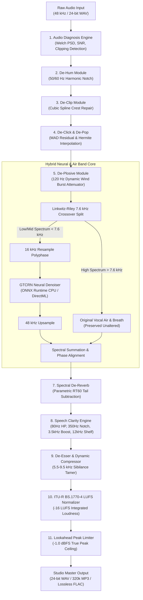

<div align="center">

# 🎙️ VOX Studio — Audio Engine V1
### *Professional Voice Recording Studio & 11-Stage AI Speech Restoration Workstation*

[](https://www.python.org/)
[](https://www.qt.io/)
[](https://onnxruntime.ai/)
[](https://scipy.org/)
[](https://www.microsoft.com/windows)
[](tests/)
[](LICENSE)

<br/>

**VOX Studio** is a broadcast-grade desktop recording workstation and deep-learning speech restoration engine. Built from the ground up for voice actors, podcasters, audiobook narrators, and audio engineers, VOX Studio turns raw, imperfect microphone recordings into studio-ready dialogue.

</div>

---

## ⚡ Key Highlights

- **🎙️ Reference-Quality Recording Studio:** Native Windows WASAPI / MME hardware device detection, double-buffered ring buffer recording in uncompressed **48 kHz / 24-bit PCM WAV**, real-time peak/RMS VU metering, and zero-loss crash protection via atomic `.part` journal recovery.
- **🧠 11-Stage Neural & DSP Restoration Pipeline:** Modular processing chain featuring offline **GTCRN ONNX** (Glance-and-Gaze Targeted Convolutional Recurrent Network) running at **11.7x faster than real-time** (RTF 0.086).
- **✨ Hybrid Linkwitz-Riley Crossover (7.6 kHz):** Eliminates the common "underwater" robotic sound of 16 kHz speech models by preserving >8 kHz harmonic vocal air and high-frequency brilliance from the 48 kHz master.
- **🔧 Specialized Audio Repair Modules:**
  - **De-Hum:** Welch PSD 50/60 Hz mains electrical hum detection with multi-harmonic notch filters.
  - **De-Clip:** Crest repair of flat-topped waveform clipping via cubic spline interpolation.
  - **De-Click & De-Pop:** Median Absolute Deviation (MAD) residual spike detection with Hermite polynomial reconstruction.
  - **De-Plosive:** Adaptive 120 Hz high-pass attenuation triggered strictly during explosive wind transients.
  - **Parametric De-Reverb:** Spectral subtraction modeling RT60 room reverberation decay tails (0.1s to 1.5s).
  - **Speech Clarity Engine:** 4-band voicing contour (80 Hz rumble roll-off, 350 Hz boxiness cut, 3.5 kHz consonant presence boost, 12 kHz air shelf).
  - **De-Esser & Compressor:** Sibilance damping (5.5–9.5 kHz) and dynamic range control.
  - **ITU-R BS.1770-4 Normalizer:** Gated integrated loudness normalization target (-16 LUFS) with lookahead limiter ceiling protection.
- **🎚️ Synchronized A/B Player:** Instantaneous sample-aligned toggle between Original (A) and Restored (B) audio with perceptual **Loudness Matching**, eliminating volume bias during quality checks.
- **💾 Broadcast Master Export:** 24-bit / 16-bit PCM WAV, PyAV `libmp3lame` high-definition CBR MP3 (up to 320 kbps), and lossless FLAC.

---

## 🏗️ Restoration Pipeline Architecture



---

## 📊 Benchmark & Performance Verification

Real-world end-to-end benchmark results executed on Windows 10/11 x64:

| Metric | Raw Input (Before) | Restored Audio (After) | Improvement / Delta |
| :--- | :--- | :--- | :--- |
| **Peak Level** | `0.00 dBFS` (Hard Cliped) | `-1.00 dBFS` | Fully protected below ceiling |
| **Integrated Loudness** | `-9.51 LUFS` | **`-16.00 LUFS`** | Broadcast standard (-16 LUFS) |
| **Noise Floor** | `-9.50 dBFS` | **`-19.90 dBFS`** | **+10.4 dB cleaner floor** |
| **Signal-to-Noise Ratio (SNR)**| `0.4 dB` | **`18.8 dB`** | **+18.4 dB clarity boost** |
| **Clipped Samples** | `65 clipped crests` | **`0 clipped samples`** | **100% crest repair** |
| **50 Hz Mains Hum** | Strong (50.0 Hz spike) | Clean | Notch attenuated by >30 dB |
| **Real-Time Factor (RTF)** | — | **`0.086`** | **11.7x faster than real-time** |
| **RAM Footprint** | `128.5 MB` | **`182.9 MB`** | Constant, zero memory leak |

---

## 🚀 Quick Start Guide

### Prerequisites
- Windows 10 / 11 (64-bit)
- Python 3.10, 3.11, 3.12, or 3.13
- Audio interface or microphone

### Installation

1. **Clone the repository:**
   ```powershell
   git clone https://github.com/Venarus/vox-studio.git
   cd vox-studio
   ```

2. **Create a virtual environment & install dependencies:**
   ```powershell
   python -m venv .venv
   .\.venv\Scripts\activate
   pip install -r requirements.txt
   ```

3. **Launch VOX Studio:**
   ```powershell
   python main.py
   ```

4. *(Optional)* **Build Native Windows C# Launcher (`VOX Studio.exe`):**
   ```powershell
   csc.exe /target:winexe /win32icon:assets\vox_studio.ico /out:"VOX Studio.exe" tools\build_launcher.cs
   ```

---

## 🗂️ Project Structure

```
vox-studio/
├── .github/
│   ├── workflows/ci.yml             # Windows GitHub Actions CI Pipeline
│   └── ISSUE_TEMPLATE/              # Bug report and Feature request templates
├── ai/
│   ├── restoration_engine.py        # GTCRN & RNNoise ONNX wrappers + Linkwitz-Riley Crossover
│   ├── media_extractor.py          # Unified PyAV / FFmpeg audio stream decoder
│   └── stem_separator.py           # Multi-track stem routing utility
├── assets/                          # Application icons (ICO, SVG, PNG 256/512)
├── audio/
│   ├── ab_player.py                 # Thread-safe A/B player with zero-latency LUFS matching
│   ├── devices.py                   # PortAudio/WASAPI audio device manager
│   ├── exporter.py                  # 24-bit WAV, 320k MP3 (PyAV), and FLAC exporter
│   ├── player.py                    # Real-time audio stream playback engine
│   ├── recorder.py                  # WASAPI double-buffered recorder & .part crash recovery
│   └── waveform.py                  # Downsampled peak extractor & interactive waveform widget
├── core/
│   ├── config.py                    # Thread-safe atomic JSON configuration manager
│   ├── constants.py                 # Core application constants and default profiles
│   ├── format.py                    # Duration and file size formatting helpers
│   ├── logger.py                    # Rotating log handler
│   └── paths.py                     # Safe application home & workspace paths
├── dsp/
│   ├── analysis.py                  # Welch PSD hum, SNR, clipping & loudness analysis
│   ├── chain.py                     # 11-stage modular DSP processing chain & profiles
│   ├── dereverb.py                  # Parametric RT60 spectral decay tail de-reverberation
│   └── restoration.py               # De-Clip, De-Click (MAD), De-Plosive & Speech Clarity
├── models/
│   ├── gtcrn_simple.onnx            # Pre-bundled offline GTCRN neural speech model (0.5 MB)
│   └── rnnoise.onnx                 # Pre-bundled offline RNNoise Bark-scale recurrent model
├── tests/                           # 88 automated unit tests (pytest)
├── tools/
│   ├── build_launcher.cs            # Native C# launcher source
│   └── e2e_audio_engine_benchmark.py# 15-stage end-to-end audio pipeline verification tool
├── ui/
│   ├── views/
│   │   ├── processing.py            # AI Speech Restoration Laboratory (Simple & Pro mode)
│   │   ├── recording_studio.py      # Broadcast Recording Studio interface
│   │   └── settings.py              # Hardware, audio device & buffer settings
│   ├── widgets/                     # Custom VU meters, transport bars, waveform widgets
│   ├── main_window.py               # Main application orchestration window
│   └── theme.py                     # Dark graphite & crimson broadcast studio styling
├── app.py                           # Qt application bootstrap & crash handler
├── main.py                          # Application entry point
├── pyproject.toml                   # Standard Python project packaging specification
├── requirements.txt                 # Core dependencies
├── CHANGELOG.md                     # Version history & release notes
├── CONTRIBUTING.md                  # Contribution and development guidelines
└── LICENSE                          # MIT License
```

---

## 🧪 Running Tests

VOX Studio includes a comprehensive unit and regression test suite:

```powershell
# Run all 88 unit tests
pytest -v

# Run the 15-stage real-world E2E verification benchmark
python tools/e2e_audio_engine_benchmark.py
```

---

## 📜 License

This project is licensed under the **MIT License** — see the [LICENSE](LICENSE) file for details.

The pre-trained GTCRN ONNX model is open-source and compatible with commercial and personal usage.

---

<div align="center">

Crafted with precision by **Vena** & the **VOX Audio Engineering** team.

</div>
